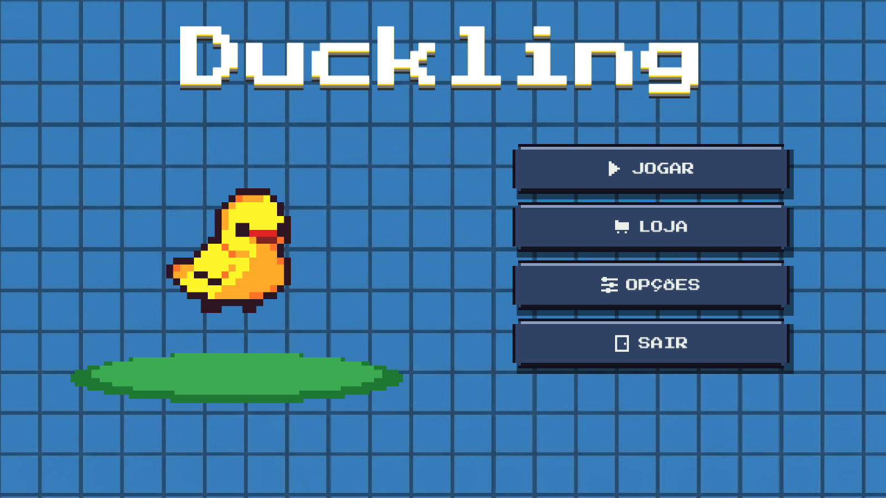

# 🦆 Duckling

Uma fazenda cheia de serviço e patos que não são lá muito confiáveis.

**Duckling** é um jogo 2D inspirado em descubrir quem é o impostor, feito em **Go + Ebiten**. Aqui, você cuida da fazenda, tenta descobrir quem está matando seus colegas e torce pra não ser o próximo.

Era pra todo mundo ajudar na colheita. Alguém entendeu “passar a foice” de outro jeito.

## 🌾 Como vai funcionar

Os patos da fazenda têm tarefas pra cumprir. Os impostores também, mas a deles é acabar com os outros patos sem levantar suspeitas.

Achou um corpo? Chame os outros e conte o que viu. Só cuidado: o pato que mais fala pode estar inventando tudo, e aquele que ficou quietinho pode só estar comendo milho.

O jogo ainda está em desenvolvimento. Por enquanto, estamos construindo a fazenda e dando aos patos motivos pra desconfiar uns dos outros.

## 🛠️ Feito com

- **Go + Ebiten** — pra fazer os patos andarem.
- **Tiled** — pra construir a fazenda.
- **Piskel** — pra desenhar os patos antes de acontecer alguma coisa com eles.

## 📋 Requisitos

- Go 1.26.
- Windows 10 ou 11.
- Tiled e Piskel, se quiser editar os mapas e as artes.

## ▶️ Bora jogar

Clone o repositório:

```bash
git clone https://github.com/sebastianjnuwu/duckling.git
```

Entre na pasta:

```bash
cd duckling
```

Baixe as dependências:

```bash
go mod download
```

Solte os patos:

```bash
go run .
```

## 📦 Compilar

Pra gerar o executável:

```bash
go build -o duckling.exe .
```

## 📸 Telas

<div align="center">
  
</div>

---

Se perguntarem, você estava no celeiro.